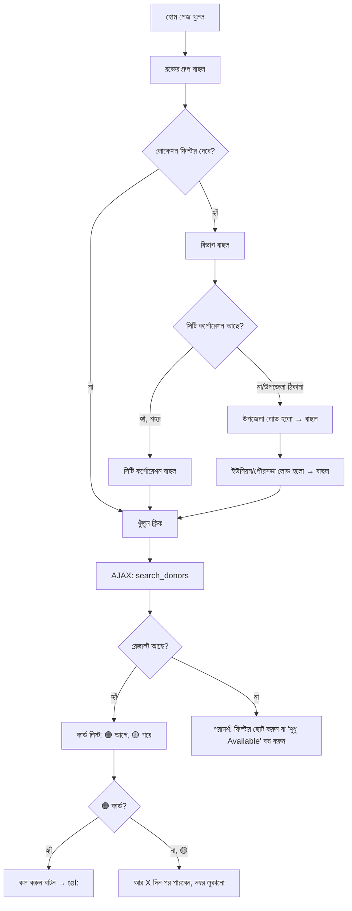
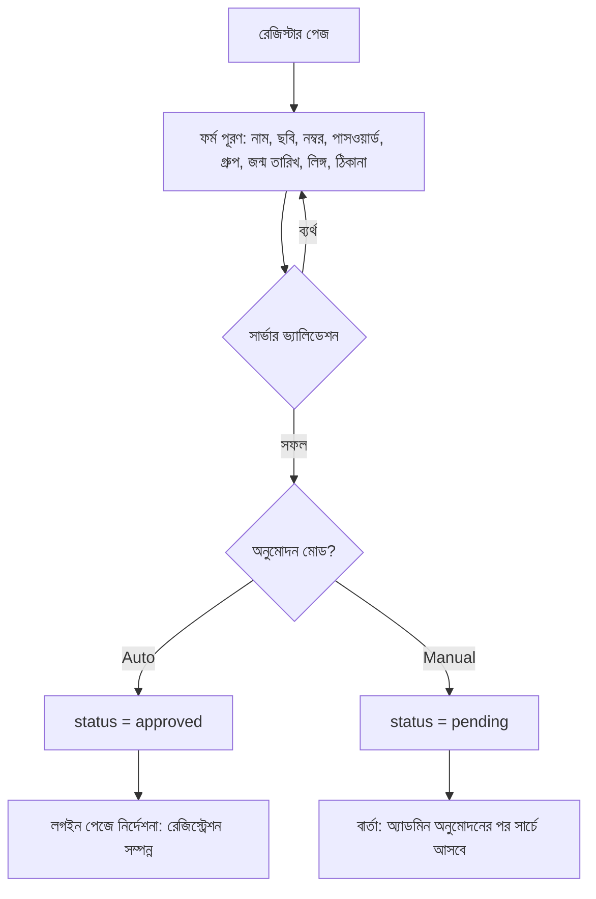
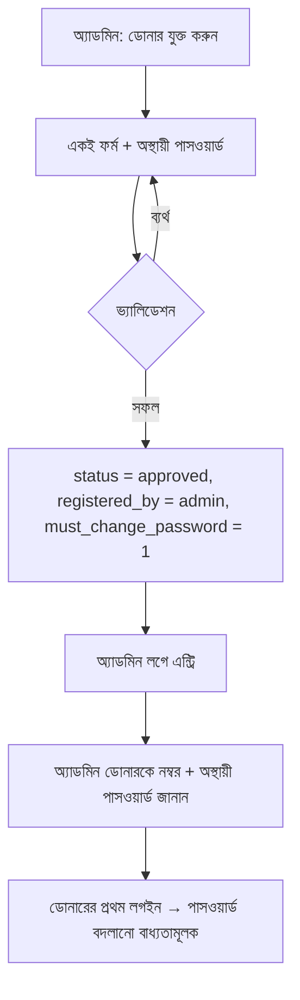
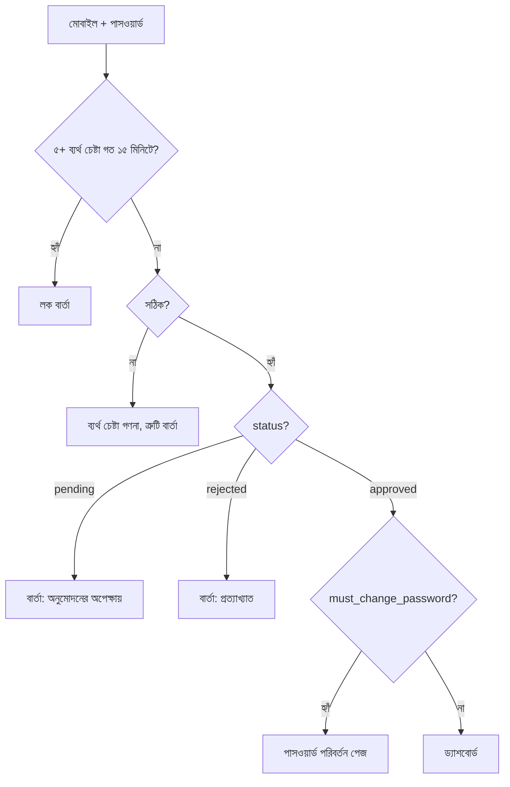
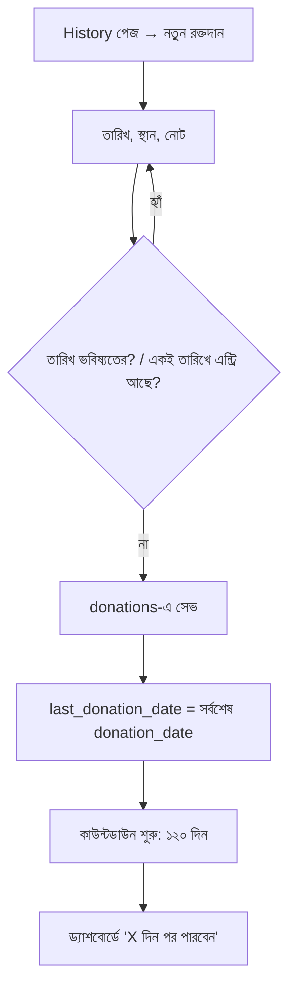
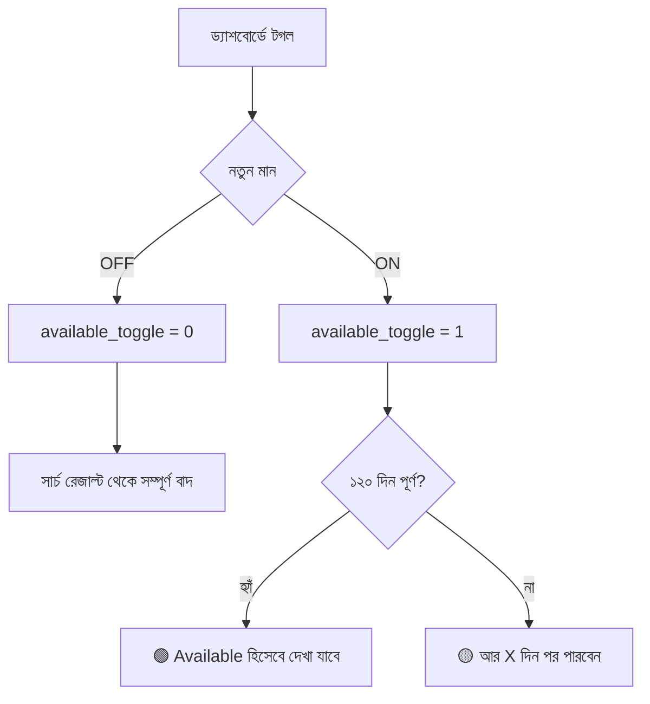
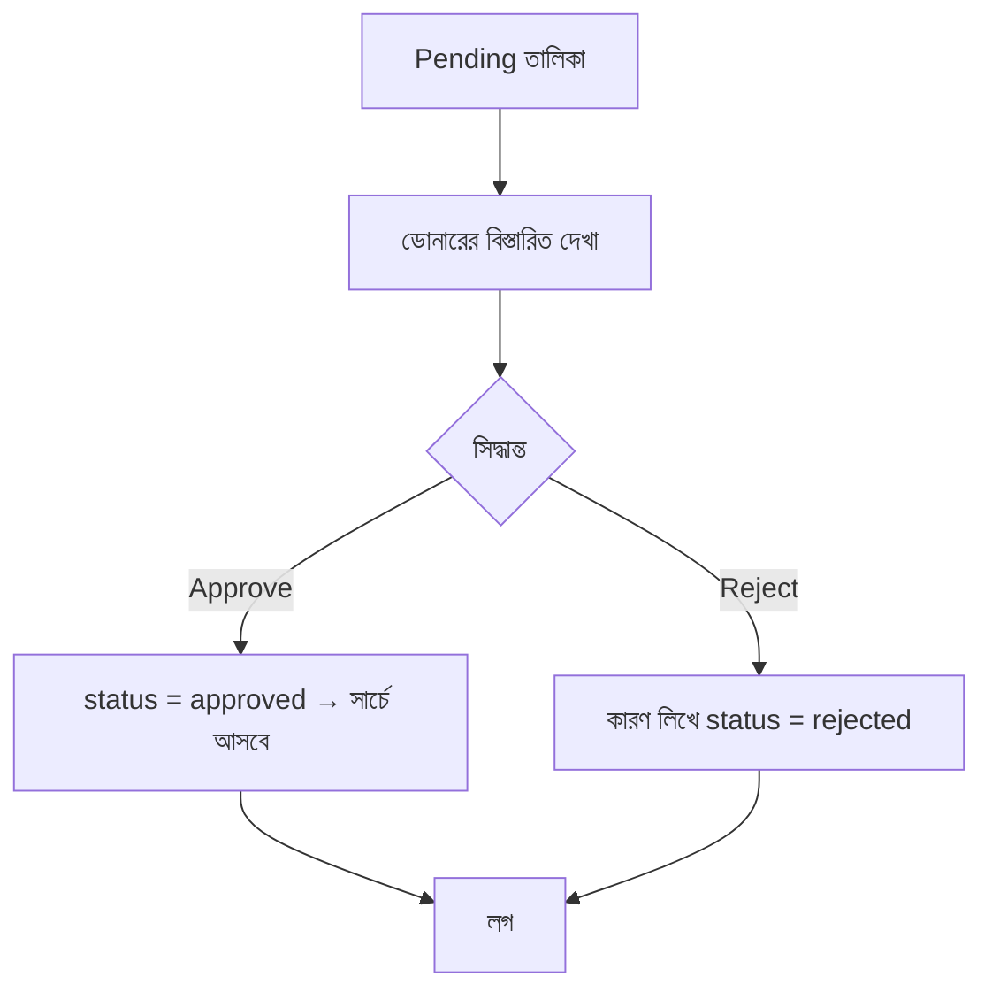
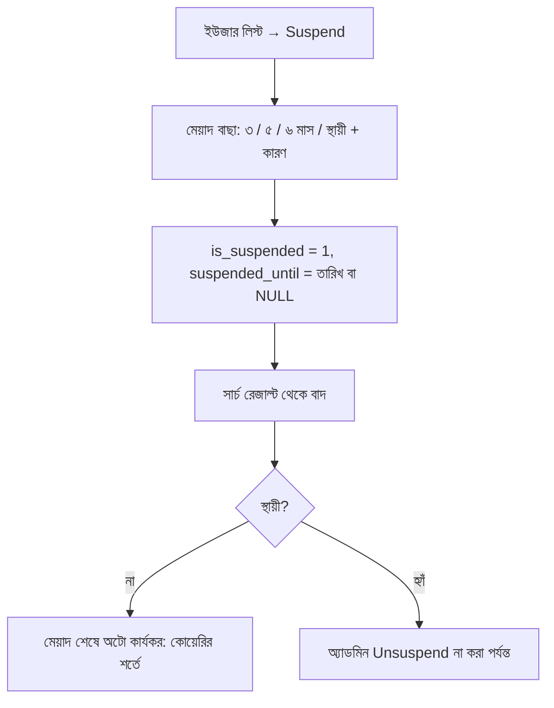
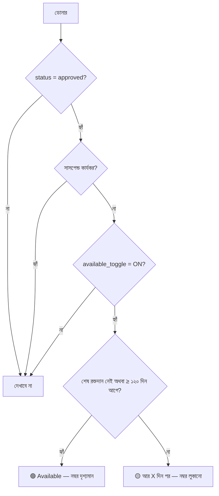
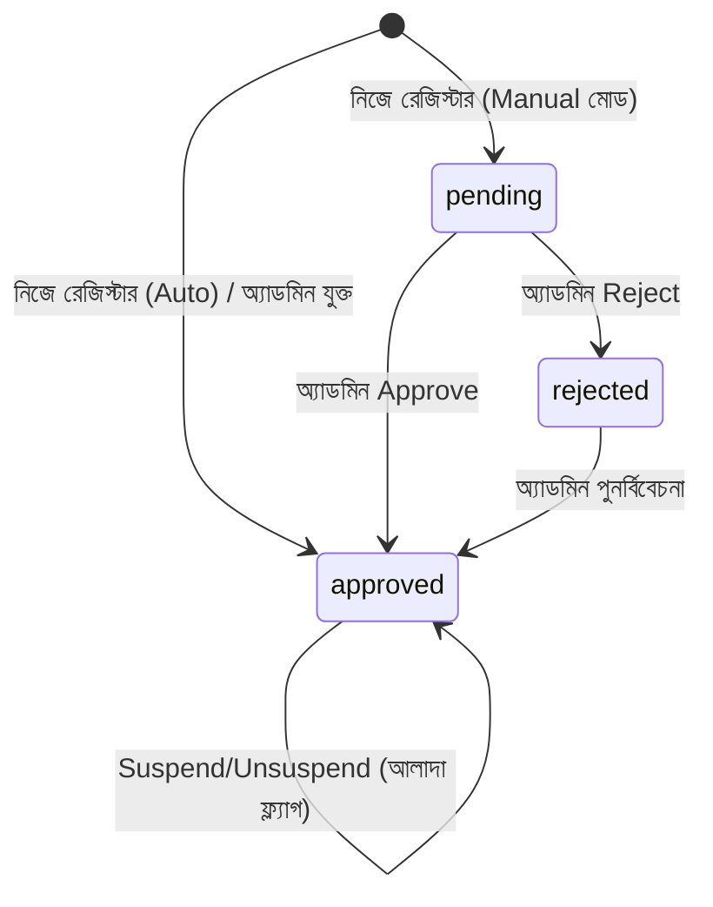

# AppFlow — অ্যাপ ফ্লো ও নেভিগেশন

এই ডকুমেন্টে সিস্টেমের পেজ কাঠামো, ব্যবহারকারীর যাত্রা (user journey) ও স্ট্যাটাস লজিক বর্ণনা করা হয়েছে। ডায়াগ্রামগুলো Mermaid-এ লেখা (GitHub, VS Code, Obsidian ইত্যাদিতে দেখা যায়)।

---

## ১. সাইটম্যাপ

```
পাবলিক
├── / (হোম + ডোনার খোঁজা)
├── /register.php        (ডোনার রেজিস্ট্রেশন)
├── /login.php           (ডোনার লগইন)
└── /about.php           (সংগঠন পরিচিতি, ডিসক্লেইমার)

ডোনার (লগইন করা)
├── /user/dashboard.php  (সারসংক্ষেপ + Available টগল)
├── /user/profile.php    (User Details)
├── /user/history.php    (রক্তদানের ইতিহাস)
└── /user/password.php   (পাসওয়ার্ড পরিবর্তন)

অ্যাডমিন
├── /admin/login.php
├── /admin/dashboard.php
├── /admin/users.php          (লিস্ট, ফিল্টার, অ্যাকশন)
├── /admin/user_add.php       (অ্যাডমিন দিয়ে ডোনার যুক্ত)
├── /admin/user_edit.php
├── /admin/pending.php        (অনুমোদনের অপেক্ষায়)
├── /admin/settings.php       (Auto/Manual, সংগঠন, নিয়ম)
└── /admin/logs.php           (অ্যাকশন লগ)
```

## ২. নেভিগেশন

| ব্যবহারকারী | নেভবার আইটেম |
|-------------|----------------|
| ভিজিটর | লোগো · ডোনার খুঁজুন · সম্পর্কে · লগইন · রেজিস্টার · 🌐 বাংলা/EN |
| ডোনার | লোগো · ডোনার খুঁজুন · ড্যাশবোর্ড · প্রোফাইল · হিস্টরি · লগআউট · 🌐 |
| অ্যাডমিন | সাইডবার: ড্যাশবোর্ড · ডোনার তালিকা · Pending · ডোনার যুক্ত করুন · সেটিংস · লগ · লগআউট |

## ৩. মূল ফ্লো

### ফ্লো ১: ডোনার খোঁজা (ভিজিটর)



ধাপ: ড্রপডাউন চেইন — উপরের স্তর বদলালে নিচের সব স্তর রিসেট হবে। সিটি কর্পোরেশন বাছলে উপজেলা/ইউনিয়ন পথ রিসেট হবে; উপজেলা পথ বাছলে সিটি কর্পোরেশন খালি থাকবে।

### ফ্লো ২: ডোনার নিজে রেজিস্টার



### ফ্লো ৩: অ্যাডমিন দিয়ে ডোনার যুক্ত



### ফ্লো ৪: লগইন



> সাসপেন্ড ডোনার লগইন করতে পারবেন, তবে ড্যাশবোর্ডে সতর্কবার্তা দেখবেন এবং সার্চ রেজাল্টে আসবেন না।

### ফ্লো ৫: রক্তদান যোগ করা (History)



### ফ্লো ৬: "আমি এখন available নই" টগল



### ফ্লো ৭: অ্যাডমিন অনুমোদন



### ফ্লো ৮: অ্যাডমিন সাসপেন্ড



## ৪. ডোনার "অবস্থা" নির্ণয়ের লজিক

প্রতিটি ডোনারের জন্য সার্চ কোয়েরি এভাবে সিদ্ধান্ত নেয়:



| অবস্থা | সার্চে (শুধু Available ON) | সার্চে (শুধু Available OFF) | নম্বর |
|--------|-------------------------------|--------------------------------|--------|
| 🟢 Available | ✅ | ✅ | দৃশ্যমান |
| 🟡 কিছুদিন পর | ❌ | ✅ | লুকানো |
| টগল OFF | ❌ | ❌ | — |
| Pending/Rejected | ❌ | ❌ | — |
| সাসপেন্ড | ❌ | ❌ | — |

## ৫. ইউজার স্ট্যাটাস স্টেট মেশিন



সাসপেন্ড আলাদা ফ্ল্যাগ (`is_suspended`, `suspended_until`), কারণ একজন `approved` ব্যক্তিকেই সাময়িক সাসপেন্ড করা হয়।

## ৬. ত্রুটি ও বিশেষ ক্ষেত্র

| পরিস্থিতি | আচরণ |
|-----------|--------|
| রেজাল্ট নেই | "কোনো ডোনার পাওয়া যায়নি" + ফিল্টার ছোট করার পরামর্শ |
| ইন্টারনেট/AJAX ব্যর্থ | "লোড করা যায়নি, আবার চেষ্টা করুন" বার্তা ও রিট্রাই বাটন |
| ডুপ্লিকেট মোবাইল নম্বর | "এই নম্বর আগেই নিবন্ধিত" |
| অবৈধ ছবি | ফাইল টাইপ/সাইজ ত্রুটি বার্তা |
| সেশন শেষ | লগইন পেজে রিডাইরেক্ট, লগইনের পর আগের পেজে ফেরা |
| অ্যাডমিন রুটে অননুমোদিত প্রবেশ | অ্যাডমিন লগইনে রিডাইরেক্ট |
| ভুল পাসওয়ার্ড বারবার | ১৫ মিনিট লক |
| ডোনার অ্যাকাউন্টে সাসপেন্ড | ড্যাশবোর্ডে সতর্কবার্তা, মেয়াদ ও কারণ সহ |
