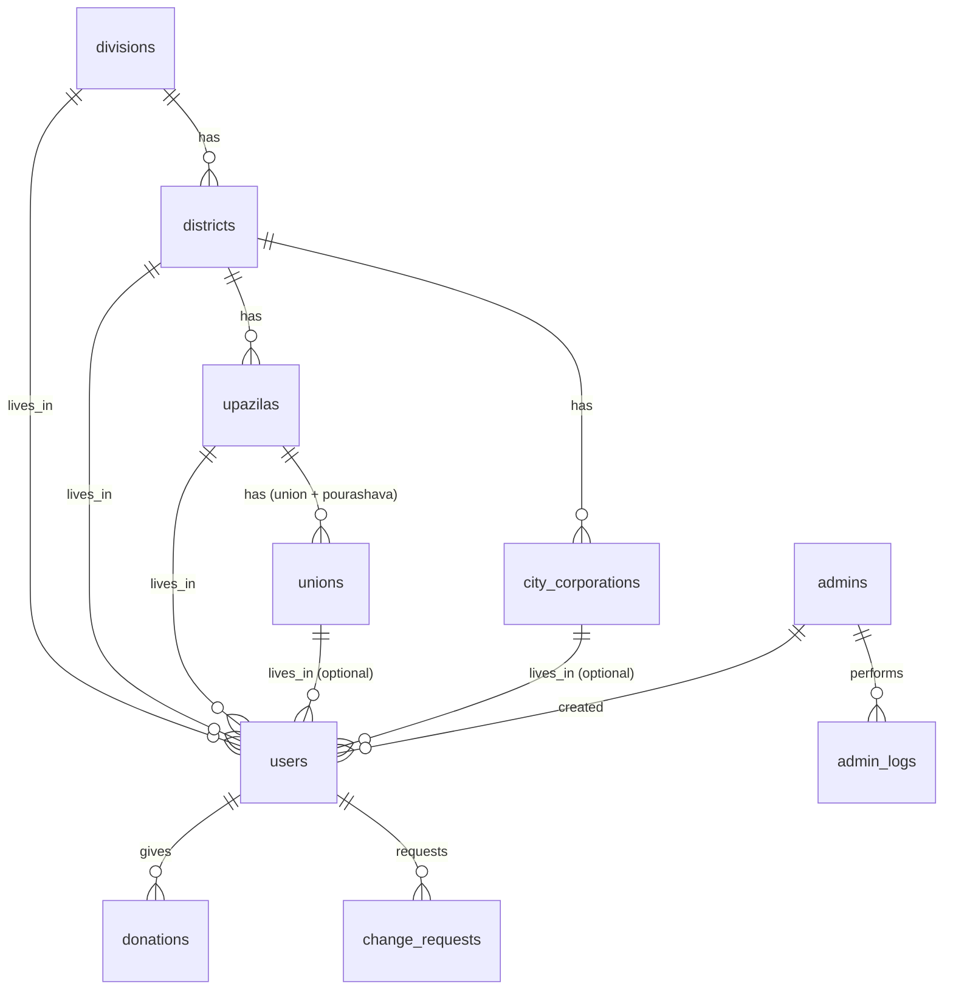

# Schema — ডাটাবেস ডিজাইন (MySQL)

**ইঞ্জিন:** InnoDB · **ক্যারেক্টার সেট:** `utf8mb4` · **কোলেশন:** `utf8mb4_unicode_ci` · **সময়অঞ্চল:** Asia/Dhaka (+06:00)
**লোকেশন ডাটা সোর্স:** [Assets/bangladesh-geo.json](../Assets/bangladesh-geo.json), iqbalhasandev/bangladesh-geo-json v2.0.0  
**বর্তমান ফাইল SHA-256:** `867b5ec7762b731b304e340f7872dfac35fc9d9a957db86952a9d00b0145f268`

---

## ০. এই ভার্সনে কী বদলেছে (আগের Schema.md থেকে)

আপনার দেওয়া আসল JSON ফাইল পরীক্ষা করে স্কিমা মেলানো হয়েছে।

| বিষয় | আগে | এখন | কারণ |
|--------|------|------|------|
| লোকেশন আইডি | JSON থেকে আসবে ধরা হয়েছিল | `AUTO_INCREMENT` | JSON-এ কোনো আইডি নেই, শুধু নাম |
| ইউনিয়ন টেবিল | শুধু ইউনিয়ন | `unions` টেবিলে `type` (`union`/`pourashava`) ও `category` (A/B/C) | JSON-এ পৌরসভা আলাদা কী-তে (`pourashavas`), ড্রপডাউনে দুটোই দেখাতে হবে |
| সিটি কর্পোরেশন | ছিল না | নতুন `city_corporations` টেবিল + `users.city_corporation_id` (ঐচ্ছিক) | JSON-এ জেলার অধীনে `city_corporations` আছে (১২টি) |
| কোঅর্ডিনেট | ছিল না | বিভাগ, জেলা ও সিটি কর্পোরেশনে `lat`, `lng` (ঐচ্ছিক) | JSON-এ আছে, ভবিষ্যতে "কাছের ডোনার"-এ লাগবে |
| ইউনিক কনস্ট্রেইন্ট | — | লোকেশন নামে `UNIQUE` নেই | সোর্সে একই উপজেলায় একই নামের ডুপ্লিকেট ইউনিয়ন আছে |

---

## ১. JSON ফাইলের আসল কাঠামো (যাচাই করা)

```json
[                                         // রুট = বিভাগের অ্যারে
  {
    "name": "Chattagram", "bn_name": "চট্টগ্রাম", "lat": "22.356851", "long": "91.783182",
    "districts": [
      {
        "name": "Comilla", "bn_name": "কুমিল্লা", "lat": "23.4682747", "long": "91.1788135",
        "city_corporations": [            // শুধু ১১টি জেলায় আছে; না থাকলে কী-ই নেই
          { "name": "Cumilla City Corporation", "bn_name": "কুমিল্লা সিটি কর্পোরেশন",
            "lat": "23.4619", "long": "91.1869" }
        ],
        "upazilas": [
          {
            "name": "Debidwar", "bn_name": "দেবিদ্বার",
            "unions":      [ { "name": "Subil", "bn_name": "সুবিল" }, ... ],
            "pourashavas": [ { "name": "Debidwar", "bn_name": "দেবিদ্বার", "category": "B" } ]
          }
        ]
      }
    ]
  }
]
```

### যাচাইয়ের ফলাফল

| স্তর | সংখ্যা | নোট |
|------|---------|------|
| বিভাগ | **৮** | সব বাংলা ও English নাম আছে; `lat`/`long` আছে |
| জেলা | **৬৪** | সব নাম আছে; `lat`/`long` আছে |
| সিটি কর্পোরেশন | **১২** (১১টি জেলায়) | ঢাকা জেলায় ২টি (উত্তর ও দক্ষিণ) |
| উপজেলা | **৪৯৫** | `unions` ও `pourashavas` কী সব উপজেলায় আছে (খালি অ্যারেও হতে পারে); কোঅর্ডিনেট নেই |
| ইউনিয়ন | **৪,৫৪০** | শুধু `name`, `bn_name`; কোনো আইডি নেই |
| পৌরসভা | **৩২৮** | `name`, `bn_name`, `category` (A=১৮৩, B=১০৪, C=৪১) |

### ডাটার বিশেষ বিষয় (ইমপোর্টে সামলাতে হবে)

1. **কোনো আইডি নেই** → ডাটাবেস নিজে আইডি দেবে; ইমপোর্ট সবসময় ফাঁকা টেবিলে একবার।
2. **`lat`/`long` স্ট্রিং** → ইমপোর্টে সংখ্যায় রূপান্তর; ফাঁকা/অবৈধ হলে `NULL`।
3. **`city_corporations` কী ঐচ্ছিক** → `?? []` দিয়ে পড়তে হবে।
4. **৩টি হুবহু ডুপ্লিকেট ইউনিয়ন** (একই উপজেলায় একই নাম ও বাংলা নাম):
   - ভোলা → চরফ্যাশন → আওয়াজপুর
   - মৌলভীবাজার → বড়লেখা → তালিমপুর
   - পঞ্চগড় → তেতুলিয়া → ভজনপুর
   → ইমপোর্টে বাদ দেওয়া হবে, ফলে ইউনিয়ন ≈ **৪,৫৩৭**।
5. **৪টি উপজেলায় ইউনিয়ন/পৌরসভা কিছুই নেই:** কক্সবাজার → ঈদগাঁও, খাগড়াছড়ি → গুইমারা, সুনামগঞ্জ → মধ্যনগর, মাদারীপুর → ডাসার → ঠিকানায় ইউনিয়ন ঐচ্ছিক রাখা হয়েছে; UI-তে নিচের ড্রপডাউন খালি হলে "প্রযোজ্য নয়" দেখাবে।
6. **৮১টি পৌরসভার নাম একই উপজেলার কোনো ইউনিয়নের নামের সাথে হুবহু মেলে** (যেমন "দেবিদ্বার" ইউনিয়নও, পৌরসভাও) → ড্রপডাউনে টাইপ সহ দেখাতে হবে: **"দেবিদ্বার (পৌরসভা)"**।
7. **ইংরেজি বানানে অসঙ্গতি:** যেমন জেলা `Comilla`, কিন্তু সিটি কর্পোরেশন `Cumilla City Corporation`; বিভাগ `Chattagram`, `Barisal`। এগুলো যেমন আছে তেমন রাখা হবে; বাংলা নাম এক। (পরে অ্যাডমিন থেকে সংশোধনের সুবিধা ভবিষ্যৎ ভার্সনে।)
8. **ভিন্ন স্তরে একই নাম** (যেমন জেলা ও উপজেলা `Debidwar`) থাকে → নাম দিয়ে নয়, সবসময় আইডি দিয়ে সম্পর্ক।

---

## ২. ER ডায়াগ্রাম



## ৩. টেবিল তালিকা

### Optional work/current donor location

`user_locations` stores one optional work/current location per donor. Existing
location columns on `users` remain the home location. `users.present_at` is
`home` or `work` and is used only for display and ordering; inactive work
locations always fall back to home.

`city_corporation_areas` stores the imported ward-level area names for city
corporations. `users.city_corporation_area_id` and
`user_locations.city_corporation_area_id` are optional and are valid only with
the corresponding city corporation. Areas can be deactivated without changing
existing donor rows.

Apply the migration with:

```sh
mysql -u YOUR_USER -p bloodlink < database/migrations/2026_11_user_work_location.sql
```

For city-corporation areas:

```sh
mysql --skip-ssl -h127.0.0.1 -uroot bl < database/migrations/2026_11_city_corporation_areas.sql
php tools/import_city_corp_json.php
```

| টেবিল | উদ্দেশ্য |
|--------|----------|
| `divisions` | বিভাগ (৮টি) |
| `districts` | জেলা (৬৪টি) |
| `city_corporations` | সিটি কর্পোরেশন (১২টি, জেলার অধীনে) |
| `upazilas` | উপজেলা (৪৯৫টি) |
| `unions` | ইউনিয়ন **ও** পৌরসভা (`type` কলাম দিয়ে আলাদা) |
| `users` | ডোনার |
| `donations` | রক্তদানের ইতিহাস |
| `change_requests` | রক্তের গ্রুপ/নম্বর পরিবর্তনের অনুরোধ |
| `admins` | অ্যাডমিন অ্যাকাউন্ট |
| `settings` | সিস্টেম সেটিংস |
| `login_attempts` | লগইন ব্যর্থ চেষ্টা |
| `admin_logs` | অ্যাডমিন অ্যাকশন লগ |

## ৪. সম্পূর্ণ SQL

```sql
CREATE DATABASE IF NOT EXISTS bloodlink
  CHARACTER SET utf8mb4 COLLATE utf8mb4_unicode_ci;
USE bloodlink;

SET time_zone = '+06:00';

-- =========================================================
-- লোকেশন: বিভাগ → জেলা → (সিটি কর্পোরেশন) / উপজেলা → ইউনিয়ন/পৌরসভা
-- আইডি AUTO_INCREMENT (JSON-এ আইডি নেই)। ইমপোর্ট শুধু ফাঁকা টেবিলে।
-- =========================================================
CREATE TABLE divisions (
  id       INT UNSIGNED AUTO_INCREMENT PRIMARY KEY,
  name_en  VARCHAR(100) NOT NULL,
  name_bn  VARCHAR(100) NOT NULL,
  lat      DECIMAL(10,7) NULL,
  lng      DECIMAL(10,7) NULL
) ENGINE=InnoDB;

CREATE TABLE districts (
  id           INT UNSIGNED AUTO_INCREMENT PRIMARY KEY,
  division_id  INT UNSIGNED NOT NULL,
  name_en      VARCHAR(100) NOT NULL,
  name_bn      VARCHAR(100) NOT NULL,
  lat          DECIMAL(10,7) NULL,
  lng          DECIMAL(10,7) NULL,
  CONSTRAINT fk_district_division FOREIGN KEY (division_id) REFERENCES divisions(id),
  INDEX idx_district_division (division_id)
) ENGINE=InnoDB;

-- সিটি কর্পোরেশন: জেলার অধীনে (উপজেলার অধীনে নয়); ঠিকানায় ঐচ্ছিক
CREATE TABLE city_corporations (
  id           INT UNSIGNED AUTO_INCREMENT PRIMARY KEY,
  district_id  INT UNSIGNED NOT NULL,
  name_en      VARCHAR(150) NOT NULL,
  name_bn      VARCHAR(150) NOT NULL,
  lat          DECIMAL(10,7) NULL,
  lng          DECIMAL(10,7) NULL,
  CONSTRAINT fk_cc_district FOREIGN KEY (district_id) REFERENCES districts(id),
  INDEX idx_cc_district (district_id)
) ENGINE=InnoDB;

CREATE TABLE upazilas (
  id           INT UNSIGNED AUTO_INCREMENT PRIMARY KEY,
  district_id  INT UNSIGNED NOT NULL,
  name_en      VARCHAR(100) NOT NULL,
  name_bn      VARCHAR(100) NOT NULL,
  CONSTRAINT fk_upazila_district FOREIGN KEY (district_id) REFERENCES districts(id),
  INDEX idx_upazila_district (district_id)
) ENGINE=InnoDB;

-- ইউনিয়ন ও পৌরসভা একই টেবিলে; UI-তে "ইউনিয়ন / পৌরসভা" ড্রপডাউন
-- কোনো UNIQUE নেই: সোর্সে একই নামের ইউনিয়ন/পৌরসভা একই উপজেলায় থাকে
CREATE TABLE unions (
  id          INT UNSIGNED AUTO_INCREMENT PRIMARY KEY,
  upazila_id  INT UNSIGNED NOT NULL,
  type        ENUM('union','pourashava') NOT NULL DEFAULT 'union',
  category    CHAR(1) NULL,                       -- শুধু পৌরসভার জন্য: A / B / C
  name_en     VARCHAR(120) NOT NULL,
  name_bn     VARCHAR(120) NOT NULL,
  CONSTRAINT fk_union_upazila FOREIGN KEY (upazila_id) REFERENCES upazilas(id),
  INDEX idx_union_upazila (upazila_id, type)
) ENGINE=InnoDB;

-- =========================================================
-- অ্যাডমিন
-- =========================================================
CREATE TABLE admins (
  id             INT UNSIGNED AUTO_INCREMENT PRIMARY KEY,
  name           VARCHAR(120) NOT NULL,
  username       VARCHAR(60)  NOT NULL UNIQUE,
  password_hash  VARCHAR(255) NOT NULL,
  role           ENUM('super','admin') NOT NULL DEFAULT 'admin',
  is_active      TINYINT(1) NOT NULL DEFAULT 1,
  last_login_at  DATETIME NULL,
  created_at     TIMESTAMP NOT NULL DEFAULT CURRENT_TIMESTAMP
) ENGINE=InnoDB;

-- =========================================================
-- ইউজার (ডোনার)
-- =========================================================
CREATE TABLE users (
  id                     INT UNSIGNED AUTO_INCREMENT PRIMARY KEY,

  -- পরিচয়
  name                   VARCHAR(120) NOT NULL,
  phone                  CHAR(11)     NOT NULL UNIQUE,          -- 01XXXXXXXXX
  password_hash          VARCHAR(255) NOT NULL,
  photo                  VARCHAR(255) NULL,
  blood_group            ENUM('A+','A-','B+','B-','AB+','AB-','O+','O-') NOT NULL,
  date_of_birth          DATE NOT NULL,                         -- বয়স এখান থেকে হিসাব হবে
  gender                 ENUM('male','female','other') NOT NULL,

  -- ঠিকানা (বিভাগ, জেলা, উপজেলা বাধ্যতামূলক; বাকি ঐচ্ছিক)
  division_id            INT UNSIGNED NOT NULL,
  district_id            INT UNSIGNED NOT NULL,
  upazila_id             INT UNSIGNED NOT NULL,
  union_id               INT UNSIGNED NULL,                     -- ইউনিয়ন বা পৌরসভা
  city_corporation_id    INT UNSIGNED NULL,                     -- শুধু শহরের ডোনারের জন্য
  village                VARCHAR(150) NULL,                     -- ডোনার নিজে লিখবেন

  -- রক্তদান অবস্থা
  last_donation_date     DATE NULL,
  available_toggle       TINYINT(1) NOT NULL DEFAULT 1,         -- 0 = "আমি এখন available নই"

  -- অনুমোদন
  status                 ENUM('pending','approved','rejected') NOT NULL DEFAULT 'pending',
  reject_reason          VARCHAR(255) NULL,
  approved_by            INT UNSIGNED NULL,
  approved_at            DATETIME NULL,

  -- সাসপেন্ড (status থেকে আলাদা)
  is_suspended           TINYINT(1) NOT NULL DEFAULT 0,
  suspended_until        DATE NULL,                             -- এই তারিখের শুরুতে suspension শেষ; NULL + is_suspended=1 = স্থায়ী
  suspend_reason         VARCHAR(255) NULL,

  -- রেজিস্ট্রেশন সূত্র ও নিরাপত্তা
  registered_by          ENUM('self','admin') NOT NULL DEFAULT 'self',
  created_by_admin_id    INT UNSIGNED NULL,
  must_change_password   TINYINT(1) NOT NULL DEFAULT 0,
  password_changed_at DATETIME NULL,
  session_version INT UNSIGNED NOT NULL DEFAULT 1,
  preferred_lang         ENUM('bn','en') NOT NULL DEFAULT 'bn',
  last_login_at          DATETIME NULL,

  created_at             TIMESTAMP NOT NULL DEFAULT CURRENT_TIMESTAMP,
  updated_at             TIMESTAMP NOT NULL DEFAULT CURRENT_TIMESTAMP ON UPDATE CURRENT_TIMESTAMP,

  CONSTRAINT fk_user_division  FOREIGN KEY (division_id) REFERENCES divisions(id),
  CONSTRAINT fk_user_district  FOREIGN KEY (district_id) REFERENCES districts(id),
  CONSTRAINT fk_user_upazila   FOREIGN KEY (upazila_id)  REFERENCES upazilas(id),
  CONSTRAINT fk_user_union     FOREIGN KEY (union_id)    REFERENCES unions(id),
  CONSTRAINT fk_user_cc        FOREIGN KEY (city_corporation_id) REFERENCES city_corporations(id),
  CONSTRAINT fk_user_approver  FOREIGN KEY (approved_by) REFERENCES admins(id) ON DELETE SET NULL,
  CONSTRAINT fk_user_creator   FOREIGN KEY (created_by_admin_id) REFERENCES admins(id) ON DELETE SET NULL,

  -- সার্চের মূল ইনডেক্স (স্ট্যাটাস → টগল → গ্রুপ → এলাকা → তারিখ)
  INDEX idx_search_upazila  (status, available_toggle, blood_group, upazila_id, last_donation_date),
  INDEX idx_search_district (status, available_toggle, blood_group, district_id),
  INDEX idx_search_division (status, available_toggle, blood_group, division_id),
  INDEX idx_search_union    (union_id),
  INDEX idx_search_cc       (city_corporation_id),
  INDEX idx_admin_list      (status, created_at)
) ENGINE=InnoDB;

-- =========================================================
-- রক্তদানের ইতিহাস
-- =========================================================
CREATE TABLE donations (
  id             INT UNSIGNED AUTO_INCREMENT PRIMARY KEY,
  user_id        INT UNSIGNED NOT NULL,
  donation_date  DATE NOT NULL,
  place          VARCHAR(200) NULL,
  note           VARCHAR(500) NULL,
  added_by       ENUM('user','admin') NOT NULL DEFAULT 'user',
  created_at     TIMESTAMP NOT NULL DEFAULT CURRENT_TIMESTAMP,
  CONSTRAINT fk_donation_user FOREIGN KEY (user_id) REFERENCES users(id) ON DELETE CASCADE,
  UNIQUE KEY uq_user_date (user_id, donation_date)              -- একই তারিখে দুটি এন্ট্রি নয়
) ENGINE=InnoDB;

-- =========================================================
-- রক্তের গ্রুপ / নম্বর পরিবর্তনের অনুরোধ (অ্যাডমিন অনুমোদন লাগে)
-- =========================================================
CREATE TABLE change_requests (
  id            INT UNSIGNED AUTO_INCREMENT PRIMARY KEY,
  user_id       INT UNSIGNED NOT NULL,
  field_name    ENUM('blood_group','phone') NOT NULL,
  old_value     VARCHAR(20) NOT NULL,
  new_value     VARCHAR(20) NOT NULL,
  status        ENUM('pending','approved','rejected','cancelled','superseded') NOT NULL DEFAULT 'pending',
  decided_by    INT UNSIGNED NULL,
  decided_at    DATETIME NULL,
  created_at    TIMESTAMP NOT NULL DEFAULT CURRENT_TIMESTAMP,
  CONSTRAINT fk_cr_user  FOREIGN KEY (user_id)    REFERENCES users(id) ON DELETE CASCADE,
  CONSTRAINT fk_cr_admin FOREIGN KEY (decided_by) REFERENCES admins(id) ON DELETE SET NULL,
  INDEX idx_cr_status (status, created_at)
) ENGINE=InnoDB;

-- =========================================================
-- সেটিংস
-- =========================================================
CREATE TABLE settings (
  setting_key    VARCHAR(60)  PRIMARY KEY,
  setting_value  VARCHAR(500) NOT NULL
) ENGINE=InnoDB;

INSERT INTO settings (setting_key, setting_value) VALUES
  ('approval_mode',      'manual'),        -- manual | auto
  ('org_name_bn',        'আমাদের ক্লাব'),
  ('org_name_en',        'Our Club'),
  ('contact_phone',      ''),
  ('support_phone',      ''),
  ('support_email',      ''),
  ('support_hours',      ''),
  ('donation_gap_days',  '120'),
  ('min_age',            '18'),
  ('max_age',            '60'),
  ('phone_visibility',   'public'),        -- public | login
  ('default_lang',       'bn');

-- =========================================================
-- লগইন ব্যর্থ চেষ্টা (রেট লিমিট)
-- =========================================================
CREATE TABLE login_attempts (
  id            INT UNSIGNED AUTO_INCREMENT PRIMARY KEY,
  identifier    VARCHAR(60) NOT NULL,                           -- ফোন বা অ্যাডমিন ইউজারনেম
  ip_address    VARCHAR(45) NOT NULL,
  scope         ENUM('user','admin') NOT NULL DEFAULT 'user',
  attempted_at  TIMESTAMP NOT NULL DEFAULT CURRENT_TIMESTAMP,
  INDEX idx_attempt (identifier, scope, attempted_at),
  INDEX idx_attempt_ip (ip_address, attempted_at)
) ENGINE=InnoDB;

-- =========================================================
-- অ্যাডমিন অ্যাকশন লগ
-- =========================================================
CREATE TABLE admin_logs (
  id             INT UNSIGNED AUTO_INCREMENT PRIMARY KEY,
  admin_id       INT UNSIGNED NOT NULL,
  action         VARCHAR(40) NOT NULL,   -- approve, reject, suspend, unsuspend, create_user, edit_user, delete_user, user_password_reset, update_settings
  target_user_id INT UNSIGNED NULL,
  details        JSON NULL,
  ip_address     VARCHAR(45) NULL,
  created_at     TIMESTAMP NOT NULL DEFAULT CURRENT_TIMESTAMP,
  CONSTRAINT fk_log_admin FOREIGN KEY (admin_id) REFERENCES admins(id),
  INDEX idx_log_admin (admin_id, created_at),
  INDEX idx_log_target (target_user_id)
) ENGINE=InnoDB;

-- =========================================================
-- ব্যবহারকারীর স্ব-সেবা অ্যাক্টিভিটি লগ
-- =========================================================
CREATE TABLE user_activity_log (
  id         INT UNSIGNED AUTO_INCREMENT PRIMARY KEY,
  user_id    INT UNSIGNED NOT NULL,
  action     VARCHAR(40) NOT NULL,
  details    JSON NULL,
  ip_address VARCHAR(45) NULL,
  created_at TIMESTAMP NOT NULL DEFAULT CURRENT_TIMESTAMP,
  CONSTRAINT fk_user_activity_user FOREIGN KEY (user_id) REFERENCES users(id) ON DELETE CASCADE,
  INDEX idx_user_activity_created (created_at),
  INDEX idx_user_activity_user (user_id, created_at)
) ENGINE=InnoDB;
```

## ৫. মূল কুয়েরি

### ৫.১ ডোনার সার্চ

প্যারামিটার: `:bg` (বাধ্যতামূলক); ঐচ্ছিক `:division`, `:district`, `:city_corp`, `:upazila`, `:union`; `:only_available` (০/১); `:gap_available`, `:gap_days_left`, `:gap_filter` (সেটিং থেকে, ডিফল্ট ১২০); `:limit`, `:offset`

```sql
SELECT
  u.id, u.name, u.photo, u.blood_group, u.gender, u.village,
  TIMESTAMPDIFF(YEAR, u.date_of_birth, CURDATE()) AS age,
  u.last_donation_date,
  d.name_bn  AS district_bn,  d.name_en  AS district_en,
  up.name_bn AS upazila_bn,   up.name_en AS upazila_en,
  un.name_bn AS union_bn,     un.name_en AS union_en,  un.type AS union_type,
  cc.name_bn AS cc_bn,        cc.name_en AS cc_en,
  CASE
    WHEN u.last_donation_date IS NULL
      OR DATEDIFF(CURDATE(), u.last_donation_date) >= :gap_available THEN 1 ELSE 0
  END AS is_available,
  CASE
    WHEN u.last_donation_date IS NULL THEN 0
    ELSE GREATEST(0, :gap_days_left - DATEDIFF(CURDATE(), u.last_donation_date))
  END AS days_left,
  -- ফোন নম্বর শুধু 🟢 হলে ফেরত যাবে; 🟡 হলে NULL
  CASE
    WHEN u.last_donation_date IS NULL
      OR DATEDIFF(CURDATE(), u.last_donation_date) >= :gap_phone THEN u.phone ELSE NULL
  END AS phone
FROM users u
JOIN districts d  ON d.id  = u.district_id
JOIN upazilas  up ON up.id = u.upazila_id
LEFT JOIN unions un ON un.id = u.union_id
LEFT JOIN city_corporations cc ON cc.id = u.city_corporation_id
WHERE u.status = 'approved'
  AND u.available_toggle = 1
  AND NOT (u.is_suspended = 1 AND (u.suspended_until IS NULL OR u.suspended_until > CURDATE()))
  AND u.blood_group = :bg
  -- ঐচ্ছিক লোকেশন (PHP থেকে শর্ত শুধু মান থাকলে যোগ হবে):
  -- AND u.division_id = :division
  -- AND u.district_id = :district
  -- AND u.city_corporation_id = :city_corp
  -- AND u.upazila_id  = :upazila
  -- AND u.union_id    = :union
  -- "শুধু Available" টগল ON হলে:
  -- AND (u.last_donation_date IS NULL OR DATEDIFF(CURDATE(), u.last_donation_date) >= :gap_filter)
ORDER BY is_available DESC, days_left ASC, u.name ASC
LIMIT :limit OFFSET :offset;
```

> এখানে `:gap_available`, `:gap_days_left`, `:gap_phone` এবং `:gap_filter` আলাদা placeholder; native PDO prepared statements-এ একই named placeholder পুনরায় ব্যবহার করা যাবে না। `phone_visibility = 'login'` সেটিং হলে PHP লেয়ারে লগইন ছাড়া `phone` ফিল্ড সবসময় `null` করা হবে।
> মোট সংখ্যা (পেজিনেশন): একই `FROM/JOIN/WHERE` দিয়ে `SELECT COUNT(*)`।

### ৫.২ ড্রপডাউন চেইন (AJAX)

```sql
SELECT id, name_bn, name_en FROM districts WHERE division_id = ? ORDER BY name_bn;

SELECT id, name_bn, name_en FROM city_corporations WHERE district_id = ? ORDER BY name_bn;
-- খালি হলে UI-তে "সিটি কর্পোরেশন" ড্রপডাউন লুকানো থাকবে

SELECT id, name_bn, name_en FROM upazilas WHERE district_id = ? ORDER BY name_bn;

-- ইউনিয়ন আগে, তারপর পৌরসভা; লেবেলে টাইপ দেখানো হবে
SELECT id, name_bn, name_en, type, category
FROM unions WHERE upazila_id = ?
ORDER BY type ASC, name_bn ASC;
```

**ড্রপডাউন লেবেল (PHP/JS):**

| `type` | বাংলা | English |
|--------|--------|---------|
| `union` | `দেবিদ্বার` | `Debidwar` |
| `pourashava` | `দেবিদ্বার (পৌরসভা)` | `Debidwar (Pourashava)` |

> ৮১টি পৌরসভার নাম একই উপজেলার ইউনিয়নের সাথে মেলে, তাই `(পৌরসভা)` লেবেল বাধ্যতামূলক। ইউনিয়ন-পৌরসভা ড্রপডাউন খালি হলে (৪টি উপজেলায়) "প্রযোজ্য নয়" দেখাবে; `union_id` `NULL` থাকবে।

### ৫.৩ রক্তদান যোগের পর `last_donation_date` আপডেট

```sql
UPDATE users u
SET u.last_donation_date = (SELECT MAX(donation_date) FROM donations WHERE user_id = u.id)
WHERE u.id = :uid;
```

রক্তদান মুছলেও একই আপডেট চালাতে হবে (সবগুলো মুছে গেলে `NULL` হবে)। `INSERT` ও আপডেট একটি ট্রানজ্যাকশনে।

### ৫.৪ অ্যাডমিন ড্যাশবোর্ড

```sql
-- রক্তের গ্রুপ অনুযায়ী সংখ্যা
SELECT blood_group, COUNT(*) AS total,
       SUM(last_donation_date IS NULL OR DATEDIFF(CURDATE(), last_donation_date) >= 120) AS available_now
FROM users
WHERE status = 'approved'
GROUP BY blood_group;

-- Pending সংখ্যা
SELECT COUNT(*) FROM users WHERE status = 'pending';
```

### ৫.৫ লগইন লক চেক

```sql
SELECT COUNT(*) FROM login_attempts
WHERE identifier = :id AND scope = :scope
  AND attempted_at >= NOW() - INTERVAL 15 MINUTE;
-- ৫ বা তার বেশি হলে লক; সফল লগইনে ওই identifier-এর পুরনো রেকর্ড মুছে ফেলা হবে
```

## ৬. ডেটা নিয়ম ও ভ্যালিডেশন

| ফিল্ড | নিয়ম |
|--------|-------|
| `phone` | `^01[3-9][0-9]{8}$`, ইউনিক |
| `date_of_birth` | বয়স `min_age`–`max_age`-এর মধ্যে |
| `donation_date` | ভবিষ্যতের নয়, `(user_id, donation_date)` ইউনিক |
| `photo` | JPG/PNG/WebP, সর্বোচ্চ ২ MB; ফাইলনেম র‍্যান্ডম |
| `village` | সর্বোচ্চ ১৫০ অক্ষর, `htmlspecialchars` দিয়ে আউটপুট |
| `district_id` | অবশ্যই নির্বাচিত `division_id`-এর অধীনে (সার্ভারে যাচাই) |
| `upazila_id` | অবশ্যই নির্বাচিত `district_id`-এর অধীনে |
| `union_id` | ঐচ্ছিক; দিলে অবশ্যই নির্বাচিত `upazila_id`-এর অধীনে |
| `city_corporation_id` | ঐচ্ছিক; দিলে অবশ্যই নির্বাচিত `district_id`-এর অধীনে |

## ৭. লোকেশন ডাটা ইমপোর্ট

### ৭.১ ধাপ

1. রিপোজিটরির `Assets/bangladesh-geo.json` ফাইলটি ব্যবহার করুন।
2. `database/schema.sql` ইমপোর্ট করুন (টেবিল তৈরি)।
3. টার্মিনালে চালান: `php tools/import_geo.php Assets/bangladesh-geo.json`
4. স্ক্রিপ্টের শেষে প্রিন্ট হওয়া সংখ্যা নিচের প্রত্যাশিত মানের সাথে মেলান।

### ৭.২ প্রত্যাশিত ফলাফল

| টেবিল | প্রত্যাশিত সারি |
|--------|------------------|
| `divisions` | ৮ |
| `districts` | ৬৪ |
| `city_corporations` | ১২ |
| `upazilas` | ৪৯৫ |
| `unions` (type=`union`) | ৪,৫৩৭ (সোর্সে ৪,৫৪০; ৩টি হুবহু ডুপ্লিকেট বাদ) |
| `unions` (type=`pourashava`) | ৩২৮ (ডুপ্লিকেট থাকলে স্ক্রিপ্ট "skipped" সংখ্যা দেখাবে) |

### ৭.৩ `tools/import_geo.php`

```php
<?php
declare(strict_types=1);

/**
 * লোকেশন ইমপোর্ট (CLI)
 * ব্যবহার: php tools/import_geo.php Assets/bangladesh-geo.json
 *
 * - শুধু ফাঁকা টেবিলে চলবে (আইডি AUTO_INCREMENT)
 * - একটি ট্রানজ্যাকশনে; কোনো ত্রুটিতে সব রোলব্যাক
 */
if (PHP_SAPI !== 'cli') { exit("CLI only\n"); }

require __DIR__ . '/../app/lib/db.php';

$file = $argv[1] ?? __DIR__ . '/../Assets/bangladesh-geo.json';
if (!is_file($file)) { exit("File not found: $file\n"); }

$data = json_decode(file_get_contents($file), true, 512, JSON_THROW_ON_ERROR);
$pdo  = db();

if ((int)$pdo->query('SELECT COUNT(*) FROM divisions')->fetchColumn() > 0) {
    exit("divisions table is not empty. Import aborted.\n");
}

function coord($v): ?string {            // "23.4682747" → দশমিক স্ট্রিং; ফাঁকা/অবৈধ → NULL
    return (is_string($v) || is_numeric($v)) && is_numeric($v) ? (string)$v : null;
}
function clean($v): string { return trim((string)$v); }

$insDiv = $pdo->prepare('INSERT INTO divisions (name_en, name_bn, lat, lng) VALUES (?,?,?,?)');
$insDis = $pdo->prepare('INSERT INTO districts (division_id, name_en, name_bn, lat, lng) VALUES (?,?,?,?,?)');
$insCc  = $pdo->prepare('INSERT INTO city_corporations (district_id, name_en, name_bn, lat, lng) VALUES (?,?,?,?,?)');
$insUp  = $pdo->prepare('INSERT INTO upazilas (district_id, name_en, name_bn) VALUES (?,?,?)');
$insUn  = $pdo->prepare('INSERT INTO unions (upazila_id, type, category, name_en, name_bn) VALUES (?,?,?,?,?)');

$n = ['div'=>0,'dis'=>0,'cc'=>0,'up'=>0,'union'=>0,'pour'=>0,'skipped'=>0];

$pdo->beginTransaction();
try {
    foreach ($data as $div) {
        $insDiv->execute([clean($div['name']), clean($div['bn_name']), coord($div['lat'] ?? null), coord($div['long'] ?? null)]);
        $divId = (int)$pdo->lastInsertId(); $n['div']++;

        foreach (($div['districts'] ?? []) as $dis) {
            $insDis->execute([$divId, clean($dis['name']), clean($dis['bn_name']), coord($dis['lat'] ?? null), coord($dis['long'] ?? null)]);
            $disId = (int)$pdo->lastInsertId(); $n['dis']++;

            foreach (($dis['city_corporations'] ?? []) as $cc) {      // কী না-ও থাকতে পারে
                $insCc->execute([$disId, clean($cc['name']), clean($cc['bn_name']), coord($cc['lat'] ?? null), coord($cc['long'] ?? null)]);
                $n['cc']++;
            }

            foreach (($dis['upazilas'] ?? []) as $up) {
                $insUp->execute([$disId, clean($up['name']), clean($up['bn_name'])]);
                $upId = (int)$pdo->lastInsertId(); $n['up']++;

                $seen = [];                                           // একই উপজেলায় হুবহু ডুপ্লিকেট বাদ
                foreach (($up['unions'] ?? []) as $un) {
                    $key = 'union|' . clean($un['name']) . '|' . clean($un['bn_name']);
                    if (isset($seen[$key])) { $n['skipped']++; continue; }
                    $seen[$key] = true;
                    $insUn->execute([$upId, 'union', null, clean($un['name']), clean($un['bn_name'])]);
                    $n['union']++;
                }
                foreach (($up['pourashavas'] ?? []) as $po) {
                    $key = 'pourashava|' . clean($po['name']) . '|' . clean($po['bn_name']);
                    if (isset($seen[$key])) { $n['skipped']++; continue; }
                    $seen[$key] = true;
                    $cat = isset($po['category']) ? strtoupper(substr(clean($po['category']), 0, 1)) : null;
                    $insUn->execute([$upId, 'pourashava', $cat, clean($po['name']), clean($po['bn_name'])]);
                    $n['pour']++;
                }
            }
        }
    }
    $pdo->commit();
} catch (Throwable $e) {
    $pdo->rollBack();
    fwrite(STDERR, "Import failed, rolled back: " . $e->getMessage() . "\n");
    exit(1);
}

echo "Divisions:           {$n['div']}\n";
echo "Districts:           {$n['dis']}\n";
echo "City corporations:   {$n['cc']}\n";
echo "Upazilas:            {$n['up']}\n";
echo "Unions:              {$n['union']}\n";
echo "Pourashavas:         {$n['pour']}\n";
echo "Skipped duplicates:  {$n['skipped']}\n";
```

### ৭.৪ ইমপোর্টের পর যাচাইয়ের কুয়েরি

```sql
SELECT 'divisions' t, COUNT(*) c FROM divisions
UNION ALL SELECT 'districts', COUNT(*) FROM districts
UNION ALL SELECT 'city_corporations', COUNT(*) FROM city_corporations
UNION ALL SELECT 'upazilas', COUNT(*) FROM upazilas
UNION ALL SELECT 'unions', COUNT(*) FROM unions WHERE type='union'
UNION ALL SELECT 'pourashavas', COUNT(*) FROM unions WHERE type='pourashava';

-- ফাঁকা নাম আছে কিনা (০ হওয়া উচিত)
SELECT COUNT(*) FROM unions WHERE name_en = '' OR name_bn = '';

-- ইউনিয়ন/পৌরসভা ছাড়া উপজেলা (৪টি হওয়া উচিত)
SELECT d.name_bn, up.name_bn
FROM upazilas up
JOIN districts d ON d.id = up.district_id
LEFT JOIN unions un ON un.upazila_id = up.id
WHERE un.id IS NULL;
```

## ৮. ব্যাকআপ ও রক্ষণাবেক্ষণ

- দৈনিক `mysqldump` (কমপক্ষে সাপ্তাহিক অফসাইট কপি)
- `login_attempts` টেবিল সাপ্তাহিক পরিষ্কার (৭ দিনের পুরনো মুছে)
- `admin_logs` ১ বছরের বেশি পুরনো আর্কাইভ করা যায়
- **লোকেশন টেবিলের আইডি কখনও বদলাবেন না।** `users` এগুলোর ওপর নির্ভর করে। JSON আপডেট হলে নতুন ডাটা আলাদা স্ক্রিপ্টে মার্জ করতে হবে, `divisions` খালি করে আবার ইমপোর্ট নয়।

## ৯. ডিজাইন সিদ্ধান্ত (কেন এভাবে)

| সিদ্ধান্ত | কারণ |
|-----------|------|
| `age` নয়, `date_of_birth` | বয়স প্রতি বছর বদলায়; জন্ম তারিখ থেকে হিসাব করলে সবসময় সঠিক |
| সাসপেন্ড আলাদা ফ্ল্যাগে | `approved` ডোনারই সাময়িক সাসপেন্ড হন; মেয়াদ শেষে স্ট্যাটাস বদলানোর জব লাগে না |
| `available_toggle` আলাদা | ১২০ দিনের নিয়ম (স্বয়ংক্রিয়) আর ডোনারের ব্যক্তিগত ইচ্ছা (ম্যানুয়াল) আলাদা বিষয় |
| `last_donation_date` ডিনরমালাইজড | সার্চ দ্রুত করতে; `donations` থেকে সবসময় সিঙ্ক রাখা হয় |
| `phone CHAR(11)` | বাংলাদেশি মোবাইল নম্বর নির্দিষ্ট দৈর্ঘ্যের |
| `donation_gap_days` সেটিংয়ে | ১২০ দিন বদলাতে চাইলে কোড বদলাতে হবে না |
| লোকেশনে `name_bn`/`name_en` | দ্বিভাষিক UI-র জন্য |
| ইউনিয়ন ও পৌরসভা এক টেবিলে (`type`) | দুটোই ঠিকানার শেষ স্তর; এক ড্রপডাউনে দেখানো যায়, কুয়েরি সহজ |
| `union_id` ঐচ্ছিক | ৪টি উপজেলায় ইউনিয়ন/পৌরসভা নেই; অনেকে শুধু উপজেলা পর্যন্ত বলতে পারেন |
| সিটি কর্পোরেশন জেলার অধীনে, ঐচ্ছিক | সোর্স ডাটায় এভাবেই; উপজেলা-ইউনিয়ন হায়ারার্কির সাথে জোর করে মেশানো হয়নি |
| লোকেশন নামে `UNIQUE` নেই | সোর্সে হুবহু ডুপ্লিকেট ও ভিন্ন স্তরে একই নাম আছে; সবসময় আইডি দিয়ে সম্পর্ক |
| `lat`/`lng` সংরক্ষণ | ভবিষ্যতে "কাছের ডোনার" ফিচারে কাজে লাগবে; এখন ব্যবহার না হলেও ক্ষতি নেই |
